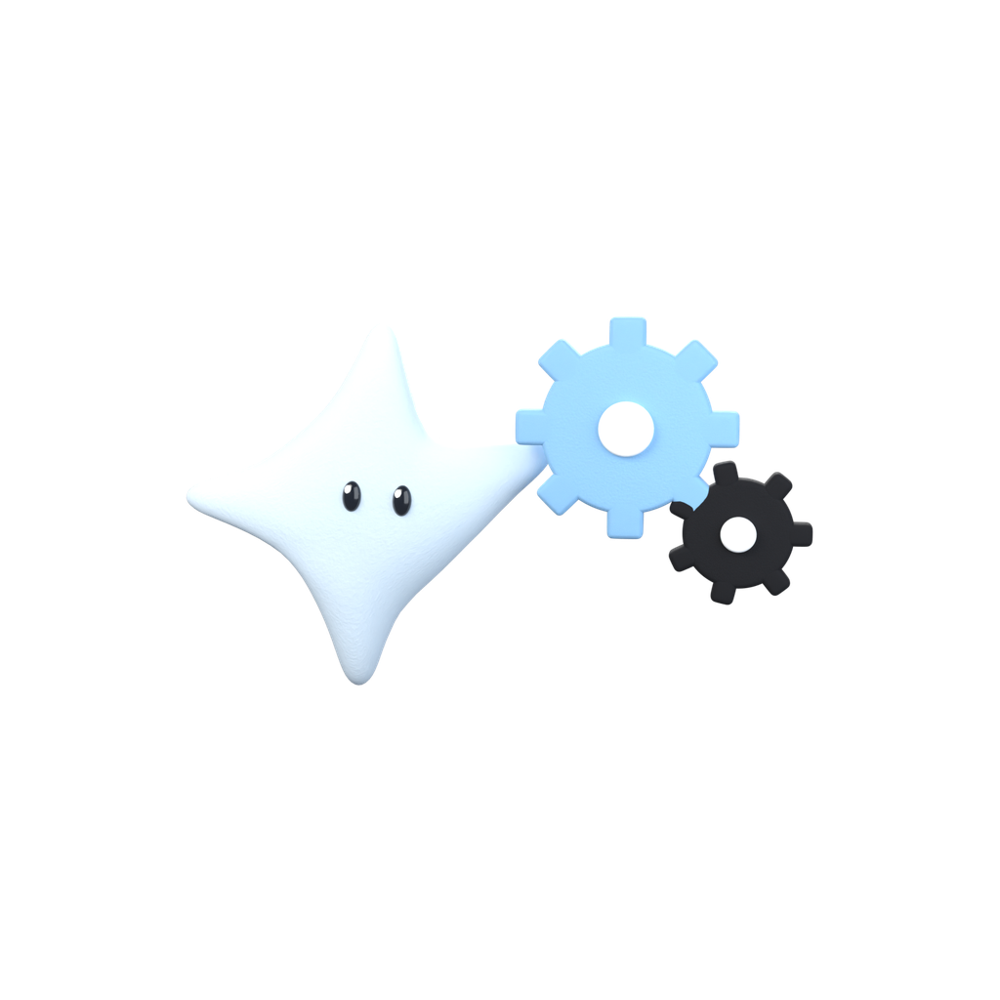
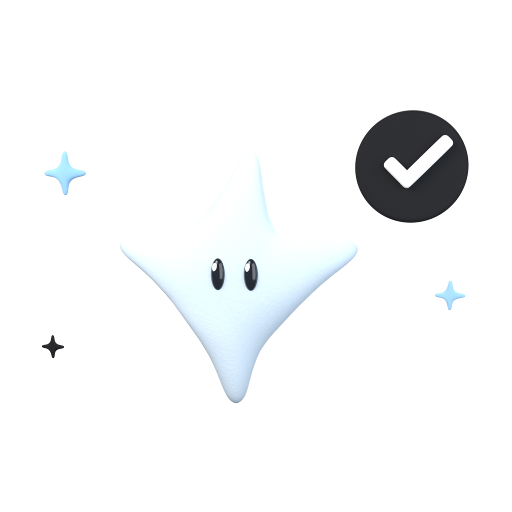
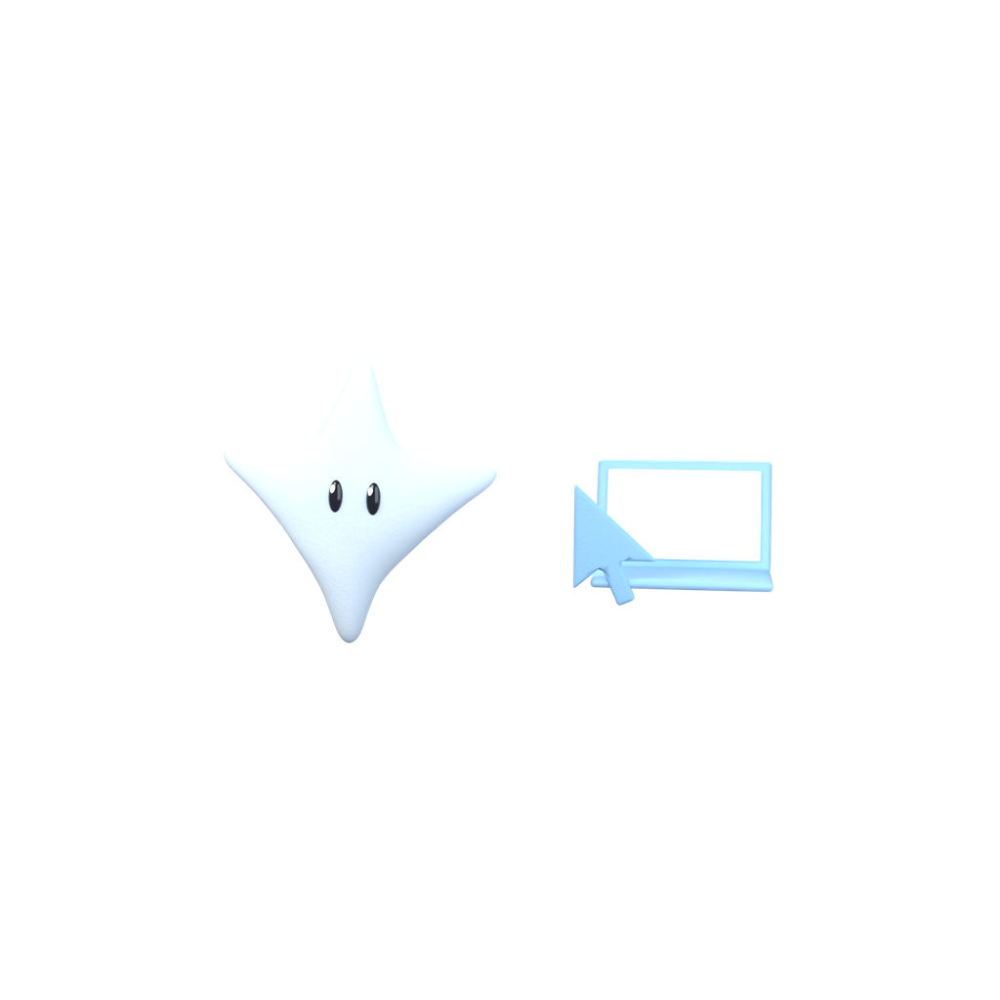
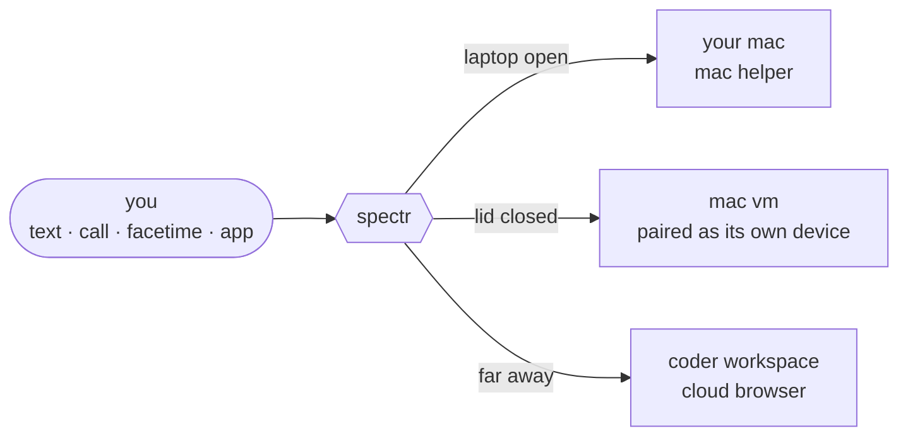
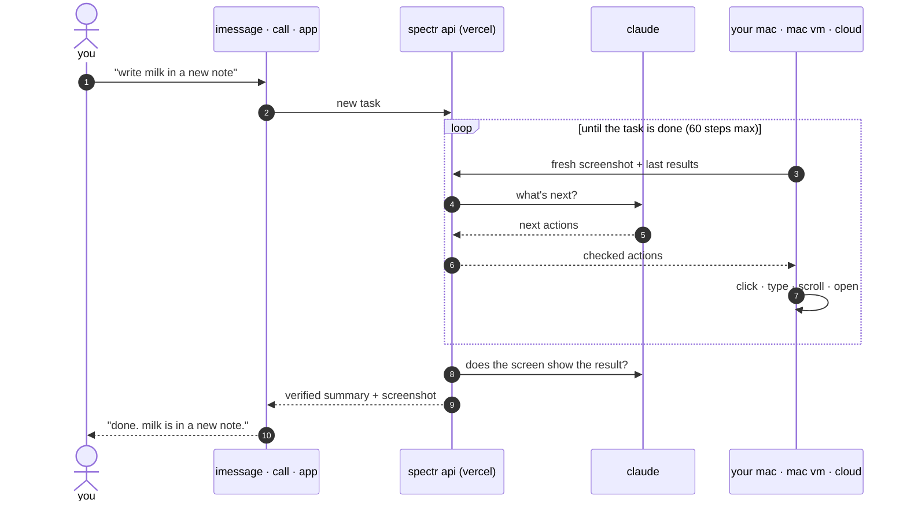
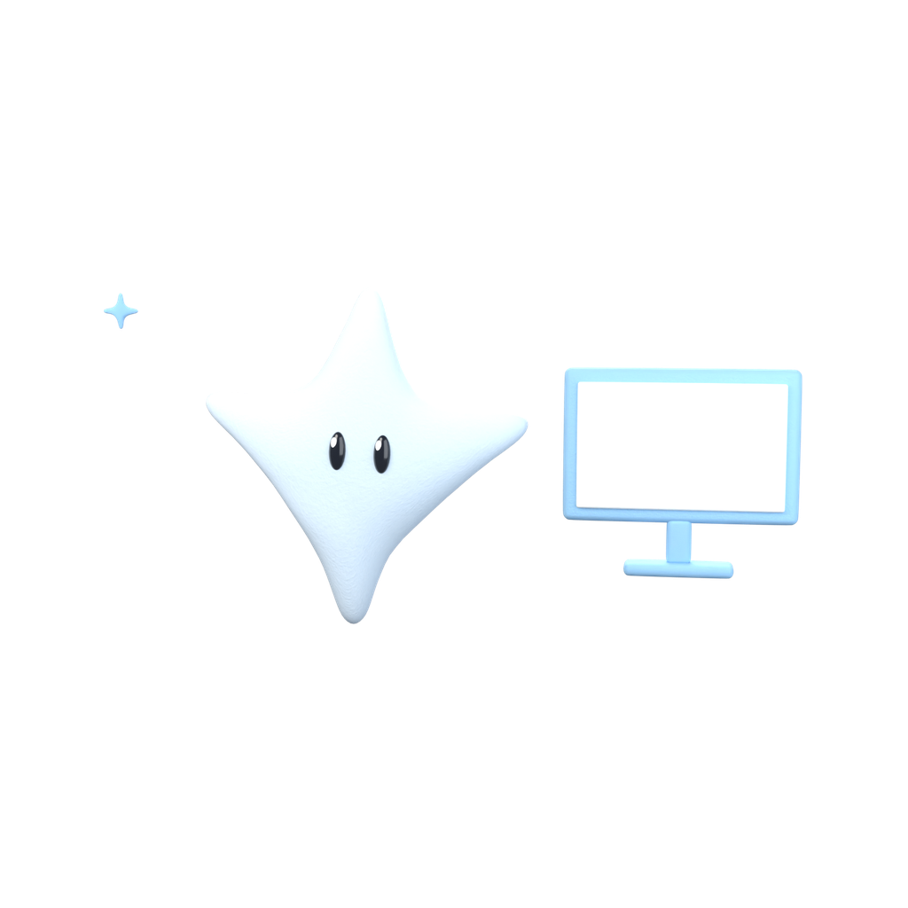
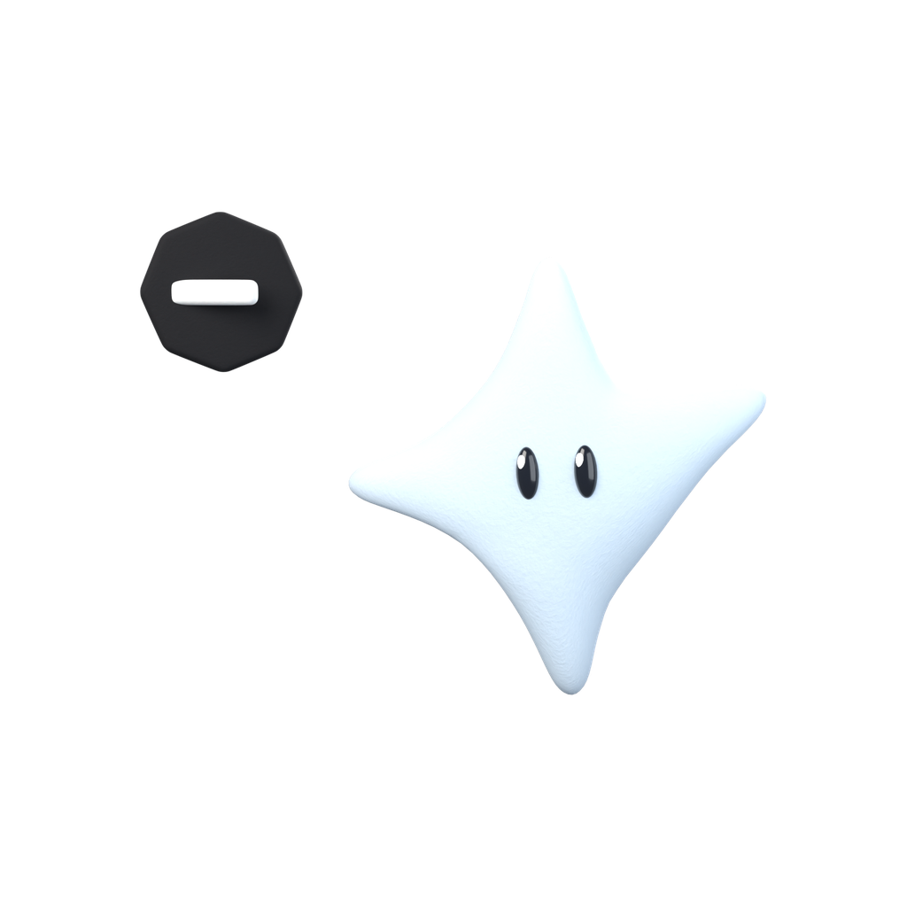

<p align="center">
  <picture>
    <source media="(prefers-color-scheme: dark)" srcset="assets/logo/flat/spectr_logo_white_transparent.png">
    
  </picture>
</p>

---

## what is spectr

spectr is an assistant that uses your computer for you.

you tell it what you need in plain words. it opens the apps and websites, clicks, types and scrolls, just like you would. then it tells you what it did in plain words too.

no new app to learn. no small buttons. no steps to remember. if you can send a text or make a call, you can use spectr.

> **you:** find the slides from this week, put them in my study folder and tell me what they cover.
>
> **spectr:** done. 4 decks are in study/week 9. they cover recursion, big o and hash maps.

## how you reach it

<table>
<tr>
<td align="center" width="25%">
<br>
<b>imessage</b><br>
<sub>text a task. get the result and a screenshot back in the same thread.</sub>
</td>
<td align="center" width="25%">
<br>
<b>phone call</b><br>
<sub>call <b>+1 (470) 596 9455</b> and just say it. spectr talks back.</sub>
</td>
<td align="center" width="25%">
<br>
<b>facetime</b><br>
<sub>facetime video spectr and see your screen as the call's video.</sub>
</td>
<td align="center" width="25%">
<br>
<b>iphone app</b><br>
<sub>chats, approvals, stop, and a live view of the screen.</sub>
</td>
</tr>
</table>

every channel feeds the same task. start by text, correct it on a call, approve it in the app. spectr keeps up.

## watch it work

most ai agents work out of sight and hand you an answer at the end. spectr works in the open.

| | |
| --- | --- |
| **see the screen live** | watch from your phone while spectr clicks and types. |
| **follow every step** | spectr says what it's doing and why, as it happens. |
| **change direction** | "use the other file." say it or text it and spectr switches. |
| **stop any time** | one word, `stop`, and it stops. |

## where it runs

spectr meets you wherever your computer is. there are three places it can do the work, and you don't have to pick. spectr sends each task to whichever of your devices checked in most recently.

<table>
<tr>
<th width="33%"><br>on your mac</th>
<th width="33%"><br>lid closed</th>
<th width="33%"><br>far from home</th>
</tr>
<tr>
<td valign="top">

**your own computer, directly.**

the spectr mac helper sits in your menu bar and works on the mac in front of you, with your apps, files and accounts already signed in.

best for anything on your machine: files, native apps, your browser.

</td>
<td valign="top">

**a mac vm that stands in for yours.**

when your laptop is shut, spectr keeps going on a macOS virtual machine paired to your account as its own device. you control it the same way, by text or call.

best for mac tasks while your laptop sleeps in your bag.

</td>
<td valign="top">

**a cloud workspace with a browser.**

when your laptop is off and far away, spectr runs in a coder workspace in the cloud with a full browser. it handles most web tasks without your computer at all.

best for searches, forms, portals and anything online.

</td>
</tr>
</table>



## how it works



1. **you ask.** a text, a call or the app turns your words into a task.
2. **spectr looks.** the device sends a screenshot of the screen you allowed it to see.
3. **claude decides.** the backend asks claude what to do next and checks every action against a short allow list.
4. **the device acts.** it clicks, types, scrolls or opens an app or website, then sends a new screenshot.
5. **repeat, then verify.** the loop continues until claude confirms the screen shows what you asked for. only then does spectr say done.

a new message during a task corrects it. `stop` ends it.

<details>
<summary><b>under the hood</b></summary>

<br>

| piece | what it does | where |
| --- | --- | --- |
| **api** | owns tasks, runs the claude step loop, texts results back | [`services/api`](services/api) on vercel |
| **call agent** | turns calls into tasks and speaks in spectr's voice | [`services/call-agent`](services/call-agent/README.md) on livekit cloud |
| **mac helper** | menu bar app that shares a screen and runs checked actions | [`apps/mac`](apps/mac) (swift) |
| **iphone app** | chats, approvals, stop, live screen and calls | [`apps/ios`](apps/ios) (swiftui) |
| **shared kit** | models and api client used by both apps | [`packages/SpectrKit`](packages/SpectrKit) |
| **landing page** | the public site and waitlist | [`apps/web`](apps/web) (next.js) |
| **database** | auth, devices, tasks and history | [`supabase`](supabase) (postgres + rls) |
| **contracts** | the json shapes every part agrees on | [`contracts`](contracts/README.md) |

built with claude computer use, sendblue (imessage), livekit (live screen and calls), elevenlabs (voice), chert (facetime), supabase and vercel.

</details>

## safety

<table>
<tr>
<td align="center" width="25%">
<br>
<b>asks first</b><br>
<sub>sending, posting, buying, submitting and deleting all wait for your yes.</sub>
</td>
<td align="center" width="25%">
<br>
<b>sees only what you share</b><br>
<sub>spectr works from the window or display you picked.</sub>
</td>
<td align="center" width="25%">
<br>
<b>never types passwords</b><br>
<sub>logins and 2fa codes stay with you. spectr pauses and asks.</sub>
</td>
<td align="center" width="25%">
<br>
<b>stop means stop</b><br>
<sub>one word ends the task and cancels anything pending.</sub>
</td>
</tr>
</table>

spectr only runs a short list of actions: screenshot, click, move, drag, scroll, type, key, wait, open an app, open a url. no shell commands. no generated scripts. your claude key stays on the server and never reaches a device.

## who it's for

<table>
<tr>
<td width="55%">

### students

> "find the slides from this week, put them in my study folder and tell me what they cover."

spectr finds the files, sorts them and texts back a short list of topics.

</td>
<td width="45%" align="center">

</td>
</tr>
<tr>
<td>

### anyone who finds computers hard

> "this website is hard for me to use. help me finish this registration and explain each choice."

spectr fills in the form step by step, explains each choice and asks before it submits.

</td>
<td align="center">

</td>
</tr>
<tr>
<td>

### developers

> "my build failed. open the pull request, read the ci logs and tell me what broke."

spectr reads the failing job and texts back what broke and where. watch from your phone and redirect it if it heads the wrong way.

</td>
<td align="center">

</td>
</tr>
<tr>
<td>

### travelers

> "i'm away from my laptop. find the doc i was working on, make this change and show me."

spectr opens the document, makes the change and sends you the result. lid closed or laptop at home, it still gets done.

</td>
<td align="center">

</td>
</tr>
</table>

## getting started

<details>
<summary><b>run spectr on your own mac</b></summary>

<br>

you need a mac that stays awake, signed in to the apps and accounts you want spectr to use.

1. **install the mac helper** from [`apps/mac`](docs/native/SETUP.md) and open it.
2. **pair it.** the helper shows a code. approve it in the spectr iphone app.
3. **allow screen recording and accessibility** when the helper asks, then pick the window or display to share.
4. **link your number** in the iphone app, then text spectr a task.

prefer the terminal? the node runner does the same job:

```sh
brew install cliclick
cd services/api && npm install
SPECTR_DEVICE_TOKEN=<token> npm run mock-mac -- --api https://spectr-api.vercel.app
```

keep your hands off the mouse and keyboard while it works.

</details>

<details>
<summary><b>work on the code</b></summary>

<br>

```sh
# backend
cd services/api && npm install && npm run typecheck && npm test

# call agent
cd services/call-agent && npm install && npm run dev

# landing page
cd apps/web && npm install && npm run dev

# iphone and mac apps
make bootstrap
```

guides: [native apps](docs/native/SETUP.md) · [call agent](services/call-agent/README.md) · [design system](design-system/README.md) · [contracts](contracts/README.md) · [example media](assets/examples/README.md)

</details>

## team

<table>
<tr>
<td align="center"><b>poorav</b><br><sub>backend · imessage</sub></td>
<td align="center"><b>sweeya</b><br><sub>agent · wording · brand</sub></td>
<td align="center"><b>colby</b><br><sub>tests · voice · cloud</sub></td>
<td align="center"><b>jared</b><br><sub>iphone and mac apps · calls</sub></td>
</tr>
</table>

<p align="center"><sub>built at emoryhacks · docs: <a href="docs/requirements.md">requirements</a> · <a href="docs/design.md">design</a> · <a href="docs/tasks.md">tasks</a></sub></p>
